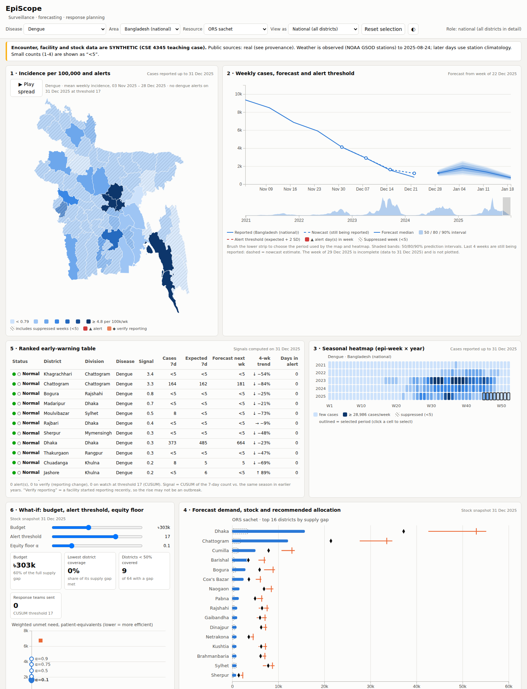
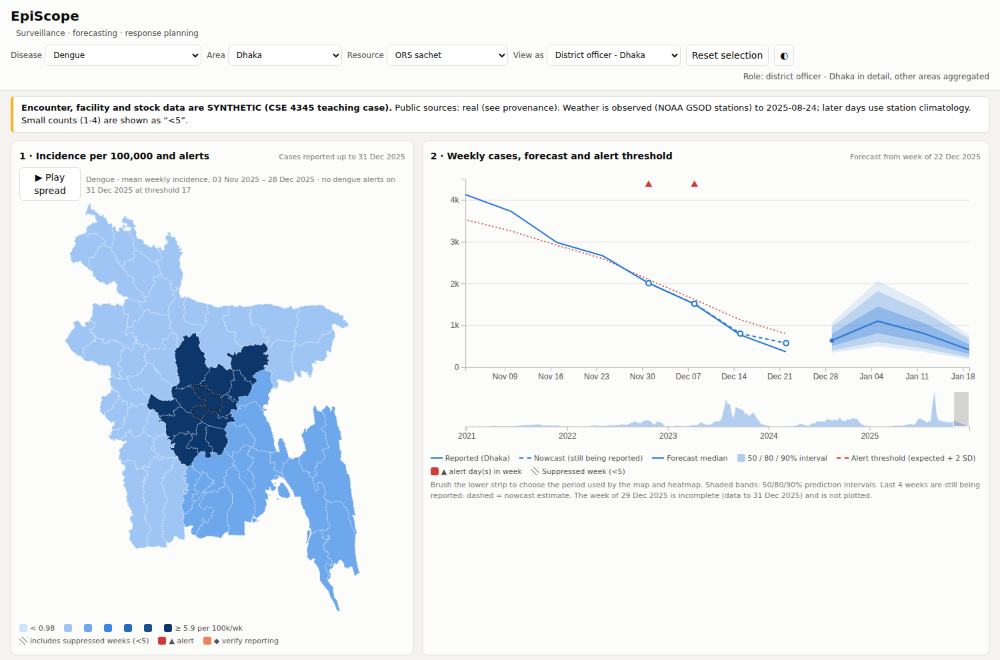
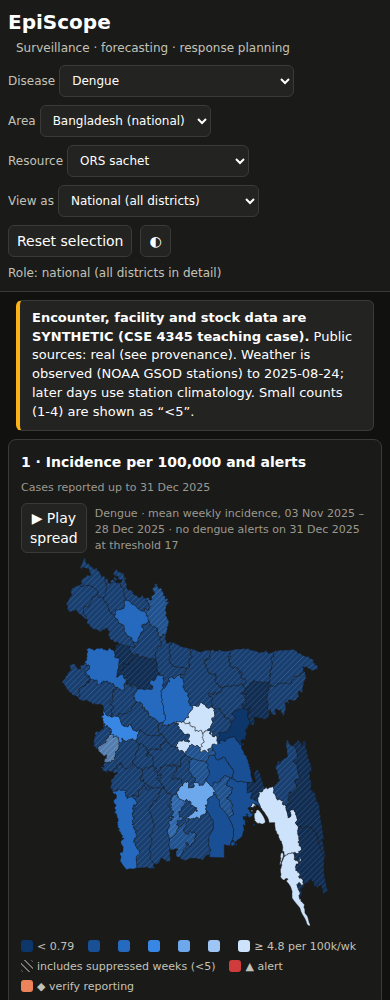
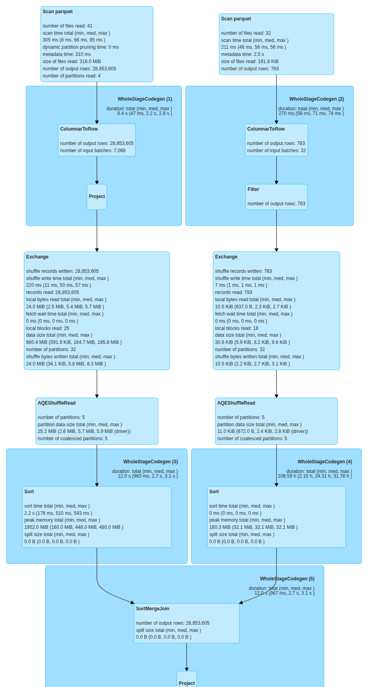
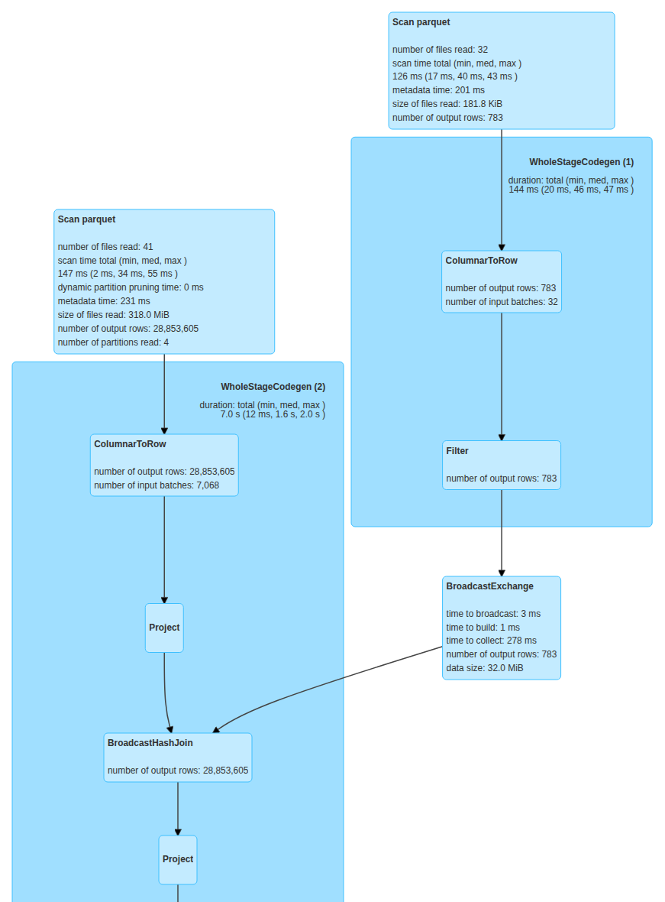

# EpiScope - Big Data Surveillance, Forecasting and Response Planning

**Video presentation:** [EpiScope video on Google Drive](https://drive.google.com/file/d/1PEtChZKgoXLoCZ7s8C676Bnu7UaYOCw3/view?usp=sharing) (19:07, 1080p, captions; chapter timestamps in [section 11](#11-video-chapters))\
**Report (PDF):** [`docs/EpiScope_report.pdf`](docs/EpiScope_report.pdf) (policy brief = Appendix A, contribution matrix = Appendix B, reflections = Appendix C) · **Proposal (M1):** [`docs/proposal.md`](docs/proposal.md) · **Risk log (M2):** [`docs/risk_log.md`](docs/risk_log.md) · **AI usage:** [`AI_USAGE.md`](AI_USAGE.md) · **Usability protocol:** [`docs/usability/`](docs/usability/)

CSE 4345 Big Data Analytics - Complex Engineering Problem, Premier University Chittagong, Spring 2026.\
Group Modulus: Partha Nath (0222220005101104, Data Engineer) · Tahmid Jamal (0222220005101083, Analytics Engineer) · Taofiq Omar Raju (0222220005101100, Visualisation Engineer)

> **All encounter, facility and stock data are synthetic** (a teaching case, not real patients). Public data:
> district boundaries from OCHA COD-AB (HDX), OpenDengue V1.3, NOAA GSOD station weather and Meta/CIESIN HRSL
> population, the last two pinned as real snapshots in `data/reference` so every clone generates the same data.
> When a public source cannot be obtained, the pipeline uses a clearly labelled synthetic fallback and says so
> in `data/landing/public/provenance.json` and in a banner on the dashboard.

---

## 1. Features

- **Outbreak early warning** per district and disease (dengue, diarrhoea/cholera, influenza-like illness, malaria):
  EARS C1/C2/C3 and a seasonal CUSUM, evaluated against injected outbreaks, with a guard that stops a
  back-filling facility from looking like an outbreak (AN-1..AN-3).
- **Forecasts 1-4 weeks ahead** for every district: per-district GLMs with rainfall and temperature lagged 4-8 weeks,
  a nowcast for weeks still being reported, 50/80/90% intervals, backtested against a seasonal-naive baseline (AN-4, AN-5).
- **Demand conversion** of case forecasts into beds, IV saline, NS1 test kits, ORS and antimalarials (AN-6).
- **Allocation optimiser**: a mixed-integer programme (HiGHS) that shares a fixed budget and rapid-response teams under
  an equity floor and transport capacity, compared with a population-share baseline, plus an efficiency-equity
  curve (AN-7, AN-8).
- **Seasonal preparedness calendar** per division and disease (STL decomposition) and **SEIR what-if scenarios** for
  a novel respiratory surge (AN-9, AN-10).
- **Spark + Delta Lake lakehouse**: bronze/silver/gold layers, 27 data-quality rules with a quarantine table, lineage
  back to the bronze batch, idempotent daily loads, late-data updates, Delta time travel and a streaming path
  (ING-*, DQ-*).
- **Privacy by design**: salted hashing, age bands, small-cell plus complementary suppression in every export, a
  k-anonymity check, and role-based views with an audit log (PRV-1..PRV-4).
- **D3.js v7 dashboard**: 9 linked views plus a what-if panel (budget, alert threshold, equity floor), freshness
  stamps, a colour-blind-safe palette, dark mode, a phone layout and animated playback (VIS-1..VIS-7).
- **One command** each to view the dashboard, rebuild everything, or ingest the hidden test drop (ENG-1).

## 2. Screenshots

**National view.** Incidence map (alert markers appear when a district is in alert; there are none on the last data
day, 31 Dec 2025), time series with forecast bands, ranked early-warning table, seasonal heatmap, what-if panel and
allocation view (`docs/report/figures/dashboard_national.png`):



<table>
<tr>
<td width="75%"></td>
<td width="25%"></td>
</tr>
<tr>
<td><b>District officer view (PRV-3):</b> Dhaka in detail, every other area only as its division aggregate.</td>
<td><b>Phone width, dark mode (VIS-7).</b></td>
</tr>
</table>

Full-page captures: [`docs/figures/`](docs/figures/).

**Spark UI, registry join with and without broadcasting (ENG-3).** Without broadcasting, Spark shuffles all
28.9 M bronze encounter rows (the SF = 1 history plus the rehearsal drops) into a SortMergeJoin. With broadcasting, only the 783-row facility registry is shipped and
the join takes 2.64 s instead of 6.68 s (2.5x, `docs/experiments/spark_optimisations.json`):

<table>
<tr>
<td width="50%"></td>
<td width="50%"></td>
</tr>
<tr>
<td><b>Broadcast disabled:</b> Exchange (shuffle) of both sides, then SortMergeJoin.</td>
<td><b>Broadcast enabled:</b> BroadcastHashJoin, no shuffle of the large side.</td>
</tr>
</table>

All Spark UI captures (partition pruning, CSV vs columnar, the SF = 1 load jobs): [`docs/experiments/screenshots/`](docs/experiments/screenshots/).

## 3. Technologies

| Component | Version | Used for |
|---|---|---|
| Python | 3.11 | all pipeline, analytics and serving code |
| Apache Spark (PySpark) | 3.5.3 | every heavy transformation, window functions, grouped `applyInPandas` (ING-2) |
| Delta Lake (delta-spark) | 3.2.1 | ACID tables, MERGE upserts, `replaceWhere`, time travel (ING-3, ING-4, ING-7) |
| Hive catalog (Derby metastore) | bundled with Spark | table registration in `episcope_bronze` / `silver` / `gold` |
| Java (OpenJDK) | 17 | Spark runtime |
| pandas / NumPy / PyArrow | 2.2.3 / 1.26.4 / 17.0.0 | pandas UDFs and small aggregated outputs |
| scikit-learn | 1.5.2 | Poisson GLM forecaster and the gradient-boosting comparator |
| statsmodels | 0.14.4 | STL seasonal decomposition (preparedness calendar) |
| SciPy | 1.13.1 | MILP optimiser (HiGHS), SEIR calibration |
| PyYAML | 6.0.2 | configuration (`config/episcope.yaml`, `config/roles.yaml`) |
| D3.js / topojson-client | 7.9.0 / 3.1.0 | dashboard views (vendored, no CDN) |
| Python standard library `http.server` | - | dashboard server with role tokens and audit log |
| pytest | 8.3.3 | automated tests |
| Make, Docker / Docker Compose | Docker 24+ | one-command runs and the orchestration entry points |
| LaTeX (IEEEtran) | - | the report PDF (`make report`) |

Every Python package is pinned in [`requirements.txt`](requirements.txt).

## 4. Prerequisites

| Need | Version | Notes |
|---|---|---|
| Linux / macOS / WSL2 (or Docker on Windows) | - | 16 GB RAM, 4 cores, ~15 GB free disk for SF = 1; viewing the dashboard (5a) works on any OS |
| Python | 3.11 | `python3 -m venv` available. The dashboard alone (5a) works with 3.9+; the full pipeline needs 3.11 or 3.12 (the pinned NumPy has no wheels for 3.13) |
| Java | **17** | Spark 3.5 supports Java 8/11/17 (not 21). The Makefile picks Java 17 automatically if it is installed in a standard location; otherwise set `JAVA_HOME` to a Java 17 install |
| make | any | Linux, macOS or WSL2 |
| Internet (first run) | - | PyPI, Maven Central (Delta Lake jars), GitHub raw (boundaries, OpenDengue); weather and population are pinned in `data/reference` |
| Docker (optional) | 24+ | alternative to the above: `docker compose up` |
| LaTeX (optional) | TeX Live or MiKTeX with `latexmk` | only for `make report` |

All Python dependencies are pinned in [`requirements.txt`](requirements.txt); D3.js v7.9.0 and
topojson-client 3.1.0 are vendored in `dashboard/vendor/` (no CDN needed).

## 5. One-command run (ENG-1)

### 5a. See the dashboard now (no Spark, no Java - about 1 minute)
The exported dashboard data (`serving/out/`, small-cell suppressed) is committed, so the dashboard runs straight
from a clean clone. **One command**, with only Python 3.9+ installed:

| Platform | Command |
|---|---|
| Windows | double-click **`run_dashboard.bat`** (or run it from a terminal) |
| macOS / Linux / Git Bash | `./run_dashboard.sh` |
| with `make` (Linux, macOS, WSL2) | `make serve` (installs the full Python environment first) |
| with `npm` | `npm run serve` (needs a `python` on PATH with PyYAML installed: `pip install pyyaml`) |

The script creates `.venv`, installs PyYAML (the server's only dependency), creates `.env` with a random salt and
role tokens on first run, starts the server at **http://127.0.0.1:8765** and **opens the browser, already signed
in as the national role** - no token to copy. Close the window (or Ctrl+C) to stop.

### 5b. Rebuild everything from scratch (lake, analytics and dashboard data)
```bash
git clone https://github.com/iparthanth/bda_pipeline episcope && cd episcope
make all          # venv + .env + public data + generator (SF=1) + bronze/silver/gold lake + analytics + dashboard data
make serve        # then open the dashboard as in 5a
```
or, with only Docker installed (brings its own Python 3.11 and Java 17):
```bash
docker compose up                    # full run, then the dashboard at http://localhost:8765
SF=0.02 docker compose up            # quick run (PowerShell: $env:SF="0.02"; docker compose up)
```

After the first run, `docker compose up --no-deps dashboard` starts only the dashboard (without `--no-deps`
Docker would run the whole pipeline again first).

`make all SF=0.25` runs a smaller scale factor. `make all` at SF = 1 (28.6 M encounter rows) took 19.6 min on a
4-vCPU / 16 GB machine (the pipeline DAG itself; the first-time setup of the virtual environment and the Delta
jars comes on top). Per-stage times for SF 0.25 / 0.5 / 1 are in `docs/experiments/scaling.csv`; the limit is 45 min.
On native Windows, use Docker or WSL2 for 5b (Spark needs Hadoop's `winutils` on Windows).

Other targets: `make test` (automated tests, section 7), `make incremental` (ingest the first future daily drop),
`make stream` (near-real-time path), `make scale` (ENG-2 experiment), `make optimisations` (ENG-3),
`make report` (rebuild the report PDF from the latest results; needs LaTeX).

### Role-based views (PRV-3)
The server checks a role token on every data request and serves each role only its own bundle: **national**
(all districts in detail) or one of three **district** roles (own district in detail, all other areas only as
division aggregates). For marking and the video the server starts in **demo mode**: the local browser is signed
in as national automatically and a **"View as"** menu in the top bar switches to a district officer's view, so the
restriction can be seen without handling tokens. `make serve ARGS=--secure` (or `python -m serving.server
--secure`) is the deployment mode: no automatic sign-in, and the dashboard asks for a token (the command prints a
link per role; tokens live only in the git-ignored `.env`). Every role-scoped data request (`/api/...`) is logged
in `data/runs/access_audit.log`.

## 6. Running the hidden 14-day test drop

1. Run `make all` once (builds the lake from the historical landing zone).
2. Put the drop anywhere, e.g. `/tmp/hidden_drop/` - any folder structure, any file names, CSV or JSON Lines.
   Files are recognised **by their header** (schema contract in `pipeline/common/schema.py`), so no names,
   dates or row counts are hard-coded.
3. Run
   ```bash
   make drop DROP=/tmp/hidden_drop
   make serve
   ```
   This ingests the drop into bronze (skipping files already loaded, by SHA-256), applies the quality rules
   (quarantine with reason codes), merges into silver (idempotent on `encounter_id`; late records update their
   epi-weeks), rebuilds the affected gold window, and regenerates **alerts, forecasts, allocation plan,
   calendar and dashboard data**. Running the same command twice changes nothing.

   **With Docker instead of `make`:** copy the drop into the project folder (it is mounted into the container),
   e.g. `hidden_drop/`, then
   ```bash
   docker compose run --rm pipeline python -m orchestration.dag drop --source hidden_drop
   docker compose up --no-deps dashboard
   ```
4. Optional check: `make inspect WHAT=idempotency` (Docker: `docker compose run --rm pipeline python -m
   orchestration.inspect_lake idempotency`) shows that every `encounter_id` is in silver exactly once, and
   `make inspect WHAT=asof` shows what the lake knew before the drop (Delta time travel) next to what it
   knows now.

The generator writes 14 rehearsal drops to `data/drops/<date>/` (same schema, including two unannounced outbreaks
and quality defects): `make drop DROP=data/drops` loads all of them at once. Rehearsed at SF = 1 with
`python -m orchestration.rehearse`, which first loads day 1 as the single incremental day (so the folder run skips
it by checksum): the other 13 days (177,864 rows, 2,823 quarantined) were ingested and every output regenerated in
10.7 min; the only two alerts raised were the two injected drop outbreaks
(`docs/experiments/hidden_drop_rehearsal.json`).

## 7. Tests

```bash
make test                                              # = .venv/bin/python -m pytest -q tests
docker compose run --rm pipeline python -m pytest -q tests   # the same inside Docker
```
414 tests. The Spark tests build a tiny lake once per run (Java 17 needed), so the full suite takes a few minutes.

| Test file | What it checks |
|---|---|
| `tests/test_quality_rules.py` | the encounter, facility and stock quality rules, with boundary cases for age, dates, ICD-10 and sex (DQ-1) |
| `tests/test_deidentification.py` | salted hashing, age bands, no identifiers beyond bronze (PRV-1) |
| `tests/test_pipeline_integration.py` | generator contract and determinism, initial load quality and lineage, idempotent re-runs and late data (ING-1, ING-4, DQ-3) |
| `tests/test_optimiser.py` | optimiser constraints: budget, equity floor, transport, teams (AN-7) |
| `tests/test_suppression.py` | no count from 1 to 4 in any export, totals cannot reveal a hidden cell, bundles <= 10 MB (PRV-2, VIS-4) |
| `tests/test_server.py` | demo vs secure sign-in, every data request needs a valid, role-scoped token (PRV-3) |
| `tests/test_orchestration.py` | DAG order, cycle detection, retries (ENG-4) |
| `tests/test_public_data.py` | pinned weather and population snapshots (S2, S3) |
| `tests/test_detection_isolation.py` | detection and the pipeline never read the ground-truth outbreak file |

Without Java/Spark (for example on native Windows), the non-Spark part runs with any Python that has NumPy,
pandas, SciPy, PyYAML, requests and pytest (341 tests):
```bash
python -m pytest -q tests/test_optimiser.py tests/test_suppression.py tests/test_server.py tests/test_orchestration.py tests/test_public_data.py tests/test_detection_isolation.py
```
`python -m orchestration.verify_submission` checks the handover items (folders, file sizes, no secrets,
traceability, tags).

## 8. Architecture summary

```
 S1 boundaries (COD-AB)  S2 population  S3 NOAA GSOD   S7 OpenDengue      S4 encounters  S5 registry  S6 stock/beds
          \________________ raw cache (landing/public) ___/                  \___ landing / drops (CSV, JSONL) __/
                                   |  ING-1: header sniffing, SHA-256 manifest, metadata (source, load_ts, batch_id, checksum)
                                   v
   BRONZE (Delta, raw strings, partitioned by batch)  --->  SILVER (Delta: typed, 27 quality rules -> quarantine,
                                                            salted hash + age bands, MERGE on encounter_id,
                                                            partitioned by epi_year x division, episode links)
                                                                    |
                                                                    v
   GOLD (Delta): weekly_counts, reporting_triangle, daily_signal, weather_weekly, stock_district_daily,
                 dq_report, lineage_batches (+ bronze_batch_ids on every case and stock row)
                                                                    |
      +-----------------------------+-----------------------------+----------------------------+
      v                             v                             v                            v
  detection (EARS window fns,   forecasting (per-district     demand (Monte-Carlo) ->      calendar (STL per
  CUSUM applyInPandas) +        GLM in applyInPandas,         optimiser (MILP, HiGHS,      division), SEIR
  evaluation vs ground truth    nowcast, backtest vs          equity floor, teams) +       scenarios, k-anonymity
                                seasonal naive, HGB)          efficiency-equity curve
      +-----------------------------+-----------------------------+----------------------------+
                                                                    v
            serving/export.py: aggregated JSON, small-cell + complementary suppression, one bundle per role (<= 10 MB)
                                                                    v
            serving/server.py (token check, audit log)  --->  D3.js v7 dashboard (9 linked views + what-if panel)
 Orchestration: Makefile -> orchestration/dag.py (dependencies, retries, timings) · Streaming: pipeline/streaming
```

Key decisions (details and alternatives in report Section III): Spark 3.5 local mode + Delta Lake (ACID MERGE,
time travel) instead of plain Parquet; Derby-backed Hive catalog (`episcope_bronze/silver/gold` databases);
daily incremental batch as the main cadence with an optional streaming path (conflict C4); interpretable
per-district GLM as the operational forecaster (C5); CUSUM on historical limits as the operational detector (C1).

## 9. Requirement traceability (ID -> code -> report section)

The "Report" column uses the PDF's numbering: Roman numeral = section, letter = subsection (IV-A = Section IV,
subsection A).

| ID | Pri. | Where in the repository | Report |
|---|---|---|---|
| ING-1 | M | `generator/` (S4-S6, `generate.py`), `generator/fetch_public.py` (S1-S3, S7), `pipeline/bronze/ingest.py` | IV-A, IV-B, IV-C |
| ING-2 | M | all heavy steps in PySpark: `pipeline/*`, `analytics/*` (`applyInPandas`, window functions) | III |
| ING-3 | M | `pipeline/silver/transform.py` (partitioned by `epi_year, adm1_pcode`), `pipeline/gold/build.py`, `pipeline/common/spark.py` (`register_table`) | III-A, III-B |
| ING-4 | M | `pipeline/silver/transform.py` (MERGE), `pipeline/gold/build.py` (`replaceWhere` window), `pipeline/run_load.py`, `tests/test_pipeline_integration.py`, `orchestration/rehearse.py` -> `docs/experiments/incremental_drop.json` | IV-C, VI-E |
| ING-5 | S | `pipeline/common/spark.py` (S3A when `lake_root` = `s3a://`), `docker-compose.yml` (MinIO profile) | III-A |
| ING-6 | S | `pipeline/streaming/stream_alerts.py`, `make stream` | III-C, VI-E |
| ING-7 | C | Delta tables everywhere; `orchestration/inspect_lake.py asof` reads `gold.weekly_counts` with `versionAsOf` ("what did we know on day t") -> `docs/experiments/time_travel.json`; the backtest uses `gold.reporting_triangle`, checked against it | III-A, VI-E |
| DQ-1 | M | `pipeline/quality/rules.py` (16 encounter + 6 facility + 5 stock rules), `silver.quarantine` | IV-D |
| DQ-2 | M | `gold.dq_report`, `gold.dq_rule_results` (`pipeline/gold/build.py::dq_tables`), dashboard "Data quality" view | IV-D, VII |
| DQ-3 | M | `bronze_batch_ids` on every case and stock gold row (`weekly_counts`, `reporting_triangle`, `daily_signal`, `stock_district_daily`), `gold.lineage_batches`, `bronze.ingest_manifest` | IV-E |
| DQ-4 | S | `pipeline/silver/dedup.py`, precision/recall in `analytics/run_analytics.py::stage_dedup_eval` | IV-D |
| PRV-1 | M | `pipeline/common/privacy.py`, `.env.example`, `orchestration/init_env.py`, `tests/test_deidentification.py` | IV-F |
| PRV-2 | M | `serving/suppress.py`, `serving/export.py`, `tests/test_suppression.py` | IV-F, VII |
| PRV-3 | S | `config/roles.yaml`, `serving/export.py::_filter_for_district`, `serving/server.py` | VII |
| PRV-4 | C | `analytics/privacy/kanon.py`, differential privacy discussion | IV-F, VIII |
| AN-1 | M | `analytics/detection/detect.py` (EARS C1/C2/C3 window functions, CUSUM `applyInPandas`) | V-A |
| AN-2 | M | `analytics/evaluation/detection_eval.py`, `docs/results/detection_tradeoff.csv` | VI-A |
| AN-3 | S | two methods + naive vs guarded variants, artefact check in `detection_eval.py` | VI-A |
| AN-4 | M | `analytics/forecast/forecast.py`, `analytics/forecast/features.py` | V-B |
| AN-5 | M | rolling-origin backtest, MAE / 80% coverage / WIS in `forecast.py::metrics` | VI-B |
| AN-6 | M | `analytics/demand/demand.py` (assumptions in `config/episcope.yaml: demand`) | V-C |
| AN-7 | M | `analytics/optimise/allocate.py` (MILP + population baseline), `tests/test_optimiser.py` | V-D, VI-C |
| AN-8 | S | `allocate.py::efficiency_equity`, `docs/results/efficiency_equity.csv` | VI-C |
| AN-9 | M | `analytics/calendar/calendar.py` (STL) | V-E |
| AN-10 | C | `analytics/scenario/seir.py` | V-F |
| VIS-1 | M | `dashboard/` (D3 v7 only, vendored) | VII |
| VIS-2 | M | `dashboard/js/views/{map,timeseries,heatmap,allocation,table}.js` (+ calendar, SEIR, DQ, evaluation) | VII |
| VIS-3 | M | `dashboard/js/app.js` (shared state + dispatch), click/brush handlers in every view | VII |
| VIS-4 | M | `serving/export.py` (aggregated bundles, sizes in `serving/out/sizes.json`), `tests/test_suppression.py` (enforces <= 10 MB) | VII |
| VIS-5 | S | `dashboard/js/views/whatif.js`, `allocate.py::scenario_grid` | VII |
| VIS-6 | S | validated colour-blind-safe palette (`dashboard/css/app.css`), bands, hatching, freshness stamps | VII |
| VIS-7 | C | responsive layout (`app.css`) + animated playback (`map.js`) | VII |
| ENG-1 | M | `Makefile`, `orchestration/dag.py`, `requirements.txt`, `Dockerfile`, `docker-compose.yml` | III-D |
| ENG-2 | M | `orchestration/scale_experiment.py`, `docs/experiments/scaling.*` | VI-D |
| ENG-3 | M | `pipeline/experiments/spark_optimisations.py`, `docs/experiments/` (+ Spark UI screenshots) | VI-D |
| ENG-4 | S | `tests/` (pytest), `orchestration/dag.py` (retries) | III-D |

## 10. Repository layout (Appendix A of the brief)

```
README.md  AI_USAGE.md  Makefile  requirements.txt  docker-compose.yml  Dockerfile  .env.example  package.json
run_dashboard.bat  run_dashboard.sh   one-command dashboard launchers (5a)
config/          episcope.yaml (all parameters), roles.yaml
generator/       fetch_public.py (S1-S3, S7), build_reference.py (pinned real S2/S3 snapshots), epi_model.py,
                 facilities.py, generate.py (S4-S6 + ground truth)
pipeline/        bronze/ silver/ gold/ quality/ streaming/ common/ experiments/ run_load.py
analytics/       detection/ forecast/ demand/ optimise/ calendar/ scenario/ privacy/ evaluation/ run_analytics.py
serving/         export.py (gold -> suppressed JSON), suppress.py, server.py, out/ (exported bundles)
dashboard/       index.html, css/, js/ (D3 modules), vendor/ (d3, topojson-client), data/geo/ (TopoJSON)
orchestration/   dag.py (DAG + retries), init_env.py, inspect_lake.py (idempotency, quarantine, time travel),
                 rehearse.py (incremental + hidden-drop rehearsal), scale_experiment.py, collect_results.py,
                 verify_submission.py (handover checks)
tests/           pytest suite (section 7)
docs/            proposal.md, risk_log.md, EpiScope_report.pdf, report/ (LaTeX), results/, experiments/, figures/,
                 video/, usability/
data/reference/  small real reference files (districts, upazilas, OpenDengue, NOAA GSOD station weather, HRSL district
                 population) - everything else in data/ is generated
```

## 11. Video chapters

Length 19:07, 1920×1080, with captions. Paste the same list into the video description.

| Time | Chapter | Presenter |
|---|---|---|
| 00:00 | Title | |
| 00:04 | 1. Problem, stakeholders and conflicts C1-C5 | Partha Nath (Data Engineer) |
| 02:39 | 2. Architecture walkthrough | Partha Nath (Data Engineer) |
| 05:05 | 3. Recorded pipeline run: clean run, one incremental day, idempotent re-run, quarantined rows | Partha Nath (Data Engineer) |
| 06:16 | 4. Analytics results against baselines | Tahmid Jamal (Analytics Engineer) |
| 12:49 | 5. Dashboard walkthrough: linked views, roles and the what-if panel | Taofiq Omar Raju (Visualisation Engineer) |
| 17:27 | 6. Recommendations, ethics and limitations | Taofiq Omar Raju (Visualisation Engineer) |

Recording plan and script: [`docs/video/video_script.md`](docs/video/video_script.md).

## 12. Data sources and licences

| Source | Licence / terms | Use |
|---|---|---|
| OCHA COD-AB Bangladesh ADM2/ADM3 v03 (HDX), via a pinned GitHub mirror | CC BY-IGO | district/upazila boundaries, centroids, facility placement |
| Meta / CIESIN High Resolution Settlement Layer population (AWS Open Data), aggregated to districts by `generator/build_reference.py` | CC BY 4.0 | population denominators by district, sex and age (S2, pinned in `data/reference`) |
| NOAA Global Surface Summary of the Day, 38 BMD stations (AWS Open Data), inverse-distance weighted to district centroids | U.S. Government open data; data from non-U.S. stations are free for non-commercial use (WMO Resolution 40) | daily rainfall, temperature, humidity per district (S3, pinned in `data/reference/gsod`) |
| Optional refresh: HDX COD-PS (BBS Census 2022) and the Open-Meteo archive | CC BY-IGO / CC BY 4.0 | `python -m generator.fetch_public --refresh` downloads these instead of the pinned snapshots |
| OpenDengue V1.3 | CC BY 4.0 | checking synthetic dengue seasonality (S7) |
| D3.js 7.9.0, topojson-client 3.1.0 | ISC | dashboard (vendored, licences in `dashboard/vendor/`) |
| Synthetic S4-S6 | generated by this repository | encounters, registry, stock |

**Why S2 and S3 are pinned snapshots.** The weather drives the synthetic epidemiology (dengue lags rainfall and
temperature), so a different weather download would generate a different dataset and different results. Pinning
real snapshots makes a clean clone reproduce the report exactly, with or without internet access. The NOAA
mirror ends on 24 Aug 2025; later days use each district's day-of-year climatology from the same stations and
are labelled `climatology_fill` in `silver.weather_daily` and on the dashboard. HRSL publishes total, men,
women, under-5, 15-24 and 60+ layers; the split of the remaining ages into the 5-14 / 25-44 / 45-64 bands, and the
assumption that 35% of the 60+ layer is aged 60-64, use the fixed proportions stated in `generator/fetch_public.py`
(the age split is discussed in the report, Section IV-A).

## 13. Troubleshooting

| Problem | Fix |
|---|---|
| Spark fails at start-up or in `applyInPandas` with Java 21 | Install Java 17 and set `JAVA_HOME` to it (Spark 3.5's Arrow does not support Java 21) |
| `make` not found on Windows | Use `run_dashboard.bat` for the dashboard and Docker (or WSL2) for everything else |
| `pip install -r requirements.txt` fails on Python 3.13 | Use Python 3.11 (or Docker): the pinned NumPy 1.26.4 has no 3.13 wheels |
| Docker run killed or very slow | Give Docker Desktop at least 12 GB of memory for SF = 1. On smaller machines run `SF=0.02` and set `SPARK_DRIVER_MEMORY=3g` |
| A new PowerShell window starts the full SF = 1 run | `$env:SF` only lasts for that window; set `$env:SF="0.02"` again before `docker compose up` |
| Docker on an Apple Silicon Mac cannot find Java | The Dockerfile sets the amd64 Java path; build and run the amd64 image instead (`DOCKER_DEFAULT_PLATFORM=linux/amd64 docker compose up`; not tested by us) |
| Port 8765 already in use | Close the other dashboard window, or start on another port: `EPISCOPE_PORT=8766 ./run_dashboard.sh` (PowerShell: `$env:EPISCOPE_PORT="8766"`) |
| The dashboard shows small-run numbers after a test run | A small `SF` run overwrites `serving/out/`; `git restore serving/out` brings back the committed SF = 1 bundles |
| `inspect_lake` prints "No lake yet" | Build the lake first: `make all` (or `docker compose up`) |
| `make report` fails | Install a LaTeX distribution with `latexmk` (TeX Live or MiKTeX) |
